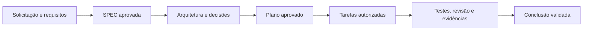
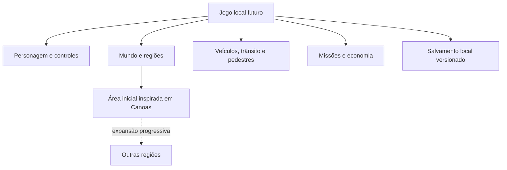

# Visão documental do template e do futuro jogo

Os blocos são responsabilidades conceituais, não módulos implementados. Infraestrutura auxiliar só será acrescentada mediante necessidade aprovada.
